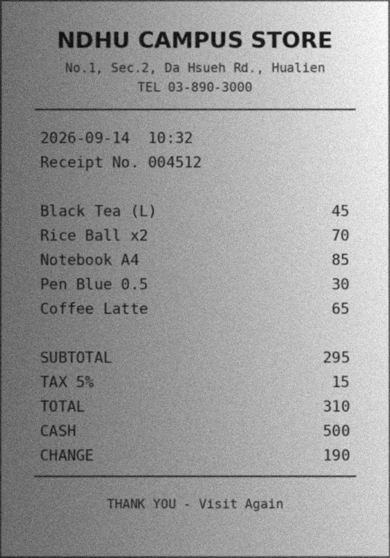
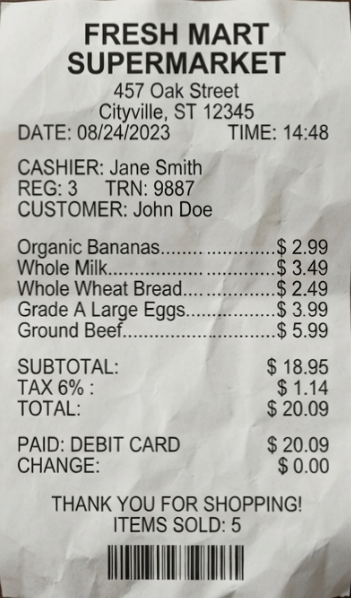
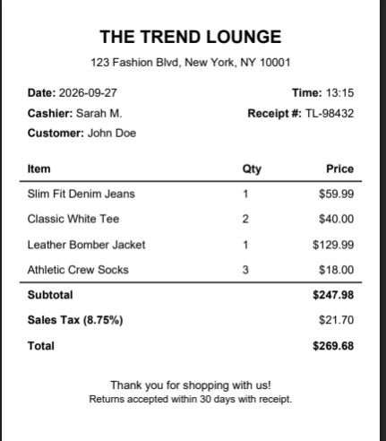

# Document Image Understanding and Enhancement System

A Python desktop prototype that enhances document images, extracts text with PaddleOCR, reconstructs document structure, and answers questions using saved OCR evidence. It supports optional cloud analysis through Groq and local analysis through Ollama (`llama3.1:8b`).

Developed as an undergraduate project at National Dong Hwa University (NDHU). **Current state: a working research prototype, with receipt demonstrations and evidence-validation tests.** OCR interpretations and model answers can still be incorrect or incomplete.

This repository contains a desktop application, not a hosted web service. Run it locally to process documents and use the Q&A interface.

## Features

| Feature | What it does |
| --- | --- |
| Single-document processing | Loads an image, detects a document boundary, and attempts perspective correction. |
| Image enhancement | Produces grayscale, illumination-corrected, contrast-enhanced and scan views. |
| OCR extraction | Extracts text regions, bounding boxes and confidence values with PaddleOCR. |
| Processing summary | Displays the selected processing route, OCR quality indicators and elapsed time. |
| Batch processing | Processes multiple document images and reports individual outcomes. |
| Unified JSON output | Saves document identity, OCR evidence and reconstructed information in a common representation. |
| Structure reconstruction | Builds candidate headings, fields, table records and other structured content. |
| Receipt interpretation | Identifies candidate receipt fields and pairs item names with printed row prices when the layout supports it. |
| Document Q&A | Answers questions about the selected processed scan. |
| Corpus Q&A | Queries a collection of saved scans using offline rules or optional model analysis. |
| Evidence validation | Checks model quotes and document/OCR IDs against supplied evidence. |
| Local comparisons | Lists candidate receipt totals and selects minimum/maximum printed item-row prices, with citations and explicit currency ambiguity. |

## What “corpus” means

The corpus is the collection of already processed documents loaded from a chosen folder. Each scan contributes its saved `unified_raw_ocr.json`, which the application reconstructs and indexes for querying.

For example, a corpus containing the campus-store, supermarket and clothing receipts lets the user ask for all receipt totals or compare item-price candidates. It is not a training dataset: loading it does not train or fine-tune Llama. The application sends relevant saved evidence with each model request.

## How answers are produced

1. The image-processing pipeline creates enhanced views and OCR evidence.
2. Reconstruction organizes that evidence into candidate document structure.
3. A question is scoped to a selected document, an explicitly named receipt, or the whole loaded corpus.
4. With model analysis enabled, Groq or Ollama selects extractive claims from supplied OCR text, layout and candidate receipt information.
5. The application checks quotes and citations. General model-selected answers are accepted only when their evidence passes these checks.
6. Supported receipt-total lists and simple item-price extrema are checked or computed locally from paired OCR evidence. These results are explicitly labelled when local selection supplies or corrects the answer.

Large Ollama requests may be split into document-level evidence extraction. General questions can require a final synthesis step; supported local receipt lists and comparisons do not require that second model response.

**Exact quotes establish provenance, not factual correctness, relevance or complete understanding.** Pairing receipt rows using geometry is also a candidate interpretation. The original OCR evidence is not rewritten to fit an answer.

## Receipt examples

These are the three receipt images supplied during development. They are demonstration examples, not a representative accuracy benchmark. The photographs below are processed views; pixel coordinates in saved OCR refer to the corresponding processing output.

### NDHU Campus Store



| Item | Printed row price |
| --- | ---: |
| Black Tea (L) | 45 |
| Rice Ball x2 | 70 |
| Notebook A4 | 85 |
| Pen Blue 0.5 | 30 |
| Coffee Latte | 65 |

**Subtotal:** 295. **Tax:** 15. **Total:** 310. The receipt does not print a currency symbol. Its lowest printed item-row price is **Pen Blue 0.5 — 30**; its highest is **Notebook A4 — 85**.

### Fresh Mart Supermarket



| Item | Printed row price |
| --- | ---: |
| Organic Bananas | $2.99 |
| Whole Milk | $3.49 |
| Whole Wheat Bread | $2.49 |
| Grade A Large Eggs | $3.99 |
| Ground Beef | $5.99 |

**Subtotal:** $18.95. **Tax:** $1.14. **Total:** $20.09. Its lowest printed item-row price is **Whole Wheat Bread — $2.49**; its highest is **Ground Beef — $5.99**.

Some OCR regions retain punctuation such as `Ground Beef.` or `.$ 5.99`. The values above are transcribed for readability; the application retains original OCR text in its citations.

### The Trend Lounge



| Item | Printed quantity | Printed row price |
| --- | ---: | ---: |
| Slim Fit Denim Jeans | 1 | $59.99 |
| Classic White Tee | 2 | $40.00 |
| Leather Bomber Jacket | 1 | $129.99 |
| Athletic Crew Socks | 3 | $18.00 |

**Subtotal:** $247.98. **Sales tax:** $21.70. **Total:** $269.68. Its lowest printed item-row price is **Athletic Crew Socks — $18.00**; its highest is **Leather Bomber Jacket — $129.99**.

Comparisons use the price printed on the item row. They do not infer a per-unit price by dividing by quantity.

## Observed live results

The following screenshots were supplied from live Windows application runs on 14 October 2026, using Q&A revision `receipt_qa_107`. The loaded corpus contained seven documents; three were classified locally as receipt candidates.

### Listing receipt totals

Question: **“List all the total of receipts.”**


| Receipt | Accepted local total | Original label and amount citations |
| --- | ---: | --- |
| NDHU Campus Store | 310 | `scan_receipt_4c095626a778:ocr_region:21`, `:ocr_region:22` |
| Fresh Mart | $20.09 | `scan_supermarket_b79744e73844:ocr_region:26`, `:ocr_region:25` |
| Trend Lounge | $269.68 | `scan_Trend_Lounge_691c78268141:ocr_region:28`, `:ocr_region:27` |

The screenshot confirms one total per receipt candidate and excludes the supplied **PAYMENT INFORMATION** form. Repeated supermarket amounts are not listed as separate totals.

The request took **20.90 seconds** in this demonstration. All seven documents were processed, but only five model outcomes passed. The payment-form and supermarket responses failed because the model quotes differed from their cited OCR text. The final answer came from **`local_receipt_total_listing`**, and its local receipt-list coverage was complete. This demonstrates the local evidence path, not flawless Llama extraction.

### Cheapest items across receipts

Question: **“What is the cheapest item in all of the receipts?”**


| Printed currency group | Selected candidate | Printed row price |
| --- | --- | ---: |
| Unspecified | NDHU Campus Store: Pen Blue 0.5 | 30 |
| `$` symbol | Fresh Mart: Whole Wheat Bread | $2.49 |

The request took **8.54 seconds** in this demonstration. All seven model outcomes passed the application's extraction checks, including legitimate `model_not_found` outcomes for irrelevant documents. The final result was **`comparison_ambiguous`** because one global monetary winner could not be established across the currency groups.

This is expected behavior, not a processing failure. A `$` symbol alone does not prove a currency denomination, and the system performs no exchange-rate conversion. The timings are observations from individual runs, not performance benchmarks.

## Questions to try

Process the relevant sample images first, then select their saved output folder in **Corpus Q&A**. These are expected results from the supplied receipt content; only the two demonstrations above are documented here as successful live outputs.

| Question | Expected result |
| --- | --- |
| List the total of all receipts. | Campus 310; Fresh Mart $20.09; Trend Lounge $269.68. |
| What is the most expensive item on the Trend Lounge receipt? Include its name and price. | Leather Bomber Jacket — $129.99. |
| What is the cheapest item on the Trend Lounge receipt? | Athletic Crew Socks — $18.00, using the printed row price. |
| What is the cheapest item on the Fresh Mart receipt? | Whole Wheat Bread — $2.49. |
| What is the cheapest item in all of the receipts? | Separate currency-group candidates rather than one global winner. |
| Who was the cashier at Trend Lounge, and where is it located? | Sarah M.; 123 Fashion Blvd, New York, NY 10001, if the model selects and cites the relevant OCR correctly. |

For **Document Q&A**, open a processed scan using **Ask About This Scan** and ask, for example, “Who was the cashier and what was the total?” The selected-document route sends that document's evidence rather than the whole corpus.

## Setup and launch

The demonstrated environment uses **Windows, Python 3.11 and CPU PaddleOCR**. Other platforms and fresh installations have not been validated by these demonstrations. The repository records a broader environment snapshot in `cpu_packages.txt`; the commands below install the main runtime packages at its recorded versions.

```powershell
git clone https://github.com/nmlandvo3-bit/document-image-understanding.git
cd document-image-understanding
git switch feature/automatic-document-structure

py -3.11 -m venv .venv-paddleocr
.\.venv-paddleocr\Scripts\Activate.ps1
python -m pip install --upgrade pip
python -m pip install paddlepaddle==3.3.1 paddleocr==3.7.0 opencv-contrib-python==4.10.0.84 numpy==2.3.5 Pillow==12.3.0
python .\app.py
```

If PowerShell blocks activation, allow scripts for the current terminal session:

```powershell
Set-ExecutionPolicy -Scope Process -ExecutionPolicy RemoteSigned
.\.venv-paddleocr\Scripts\Activate.ps1
```

Initial OCR startup may download model files. Later runs can reuse the model cache. Supported image inputs are JPG/JPEG, PNG, BMP and WebP; direct PDF input is not exposed in this GUI.

The configured OCR path uses `OCR_DEVICE = "cpu"` and `OCR_ENABLE_MKLDNN = False`. The processing engine also sets `FLAGS_enable_pir_api=0` before importing PaddleOCR for the validated Windows configuration. Do not assume OCR GPU support from the presence of a GPU on the development machine.

### Local Ollama analysis

Install and start [Ollama](https://ollama.com/), then download the model:

```powershell
ollama pull llama3.1:8b
ollama list
```

The application uses the local chat endpoint at `http://127.0.0.1:11434/api/chat` through a standard-library adapter. Select **Ollama (local)** in the Q&A provider menu. In Corpus Q&A, also enable **model analysis**; with that checkbox off, the application uses its offline query rules.

By default, the adapter grows the request context conservatively from 8,192 up to 32,768 when needed. To use a fixed context budget, set this environment variable before launching:

```powershell
$env:DOCUMENT_QA_OLLAMA_NUM_CTX = "8192"
python .\app.py
```

An explicit budget is respected. Larger budgets can require more memory and take longer. Model downloads require internet access; local Q&A inference uses the loopback endpoint.

### Optional Groq cloud analysis

```powershell
python -m pip install groq
$env:GROQ_API_KEY = "YOUR_GROQ_API_KEY"
python .\app.py
```

Select **Groq (cloud)** and enable model analysis for corpus requests. This route sends supplied OCR evidence to the cloud provider. The configured analysis model is `openai/gpt-oss-20b`; provider availability, limits and access can change. Store actual keys outside Git. The application does not automatically switch from Ollama to Groq when a local request fails.

## Output and corpus folders

| Location | Purpose |
| --- | --- |
| `results/gui_v4/single/` | Generated single-scan outputs and the default corpus folder. |
| `results/gui_v4/batch/` | Generated batch outputs and summaries. |
| Each scan's `unified_raw_ocr.json` | Saved unified OCR evidence used for reconstruction and Q&A. |
| Each scan's `processing_summary.json` | Processing route, quality and artifact information. |
| `logs/app.log` | Runtime log. |
| `docs/images/` | Receipt examples and result screenshots used in this README. |

The generated `results/` tree and local `data/` inputs are excluded from Git, so a fresh clone has no saved scan corpus. Create it by processing the example images, or choose an existing folder of compatible saved scan results. README result screenshots are observations, not OCR JSON inputs.

## Code guide

| File | Responsibility |
| --- | --- |
| `app.py` | Tkinter GUI, scan actions, provider selection and answer presentation. |
| `config.py` | Paths, OCR settings and quality thresholds. |
| `scripts/document_scanner.py` | Boundary detection, perspective correction and enhancement. |
| `scripts/document_processing_engine.py` | OCR execution, quality assessment, recovery routes and saved outputs. |
| `parsing/unified_structured_document_builder.py` | Candidate document structure reconstruction. |
| `services/processed_scan_corpus.py` | Loads saved scans and builds the corpus index. |
| `services/corpus_question_router.py` | Offline corpus query rules. |
| `services/corpus_groq_assisted.py` | Shared model-analysis contract, scope resolution, quote validation and batching. |
| `services/document_groq_analysis.py` | Selected-document Q&A using either provider. |
| `services/ollama_client.py` | Local Ollama request adapter and context management. |
| `services/receipt_qa_context.py` | Receipt-total candidates and local total listing. |
| `services/receipt_item_qa.py` | Item–price geometry, receipt scope and minimum/maximum comparison. |
| `services/corpus_qa_presentation.py` | Answer/evidence display, model failures and local-selection labels. |

Some filenames retain `groq` from the original integration even though their current analysis functions support both providers.

## Verification

The revision-107 Q&A regression experiments **98–107 passed 176 offline checks** during development. They use mock provider responses and make no OCR, Groq, Ollama or network requests. This count does not certify general model accuracy or the full image-processing pipeline.

Run them independently from the repository root:

```powershell
python -m experiments.experiment_98_corpus_analysis
python -m experiments.experiment_99_selected_document_analysis
python -m experiments.experiment_100_ollama_analysis
python -m experiments.experiment_101_ollama_corpus_batches
python -m experiments.experiment_102_ollama_receipt_totals
python -m experiments.experiment_103_general_local_questions
python -m experiments.experiment_104_receipt_item_comparison
python -m experiments.experiment_105_named_receipt_scope
python -m experiments.experiment_106_receipt_total_listing
python -m experiments.experiment_107_screenshot_questions
git diff --check
```

Checks cover invalid quotes/IDs, wrong-document citations, context budgets, named versus all-receipt scope, incomplete model processing, totals, duplicates, item names and prices, ties, currency ambiguity and the eight question phrasings used in the screenshot review.

The campus, supermarket and payment-form fixtures come from supplied OCR. Trend Lounge tables used in the comparison regressions are synthetic fixtures; they are not the actual Trend OCR export. The live total-list screenshot separately confirms the actual Trend total and its citations.

The evidence panel displays **`Q&A revision: receipt_qa_107`** when this analysis revision is loaded.

## Current limitations and next work

- General Llama answers can still be incomplete, irrelevant or fail quote/citation checks. Successful formatting or citations do not prove semantic correctness.
- Local receipt interpretation supports specific layouts. Missing, conflicting or unsupported rows produce incomplete results rather than inferred values.
- Item comparisons use printed row prices, not inferred unit prices. Currency conversion and verified currency identification are not implemented.
- The local question helpers recognize a set of common English phrasings; broader natural-language intent handling still needs evaluation.
- OCR errors, image quality and structure reconstruction can affect every later answer.
- Q&A latency includes model work even when local receipt evidence ultimately supplies the answer. Further routing and performance improvements are planned.
- Testing has focused on a small demonstration set and the recorded Windows environment. Wider document/language coverage, clean-install testing and a larger live-model evaluation set are next steps.

Planned improvements include clearer result presentation, additional real OCR regression fixtures, improved general question interpretation, broader document testing and simpler installation.

## Project status and license

This project is shared for demonstration, study and continued development. See the repository history for updates. A public repository is not itself an open-source license; use the repository's `LICENSE` file if one is added. No license is selected by this README.
